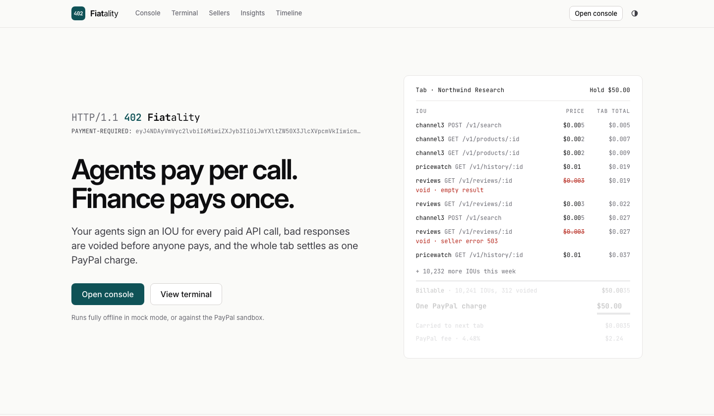
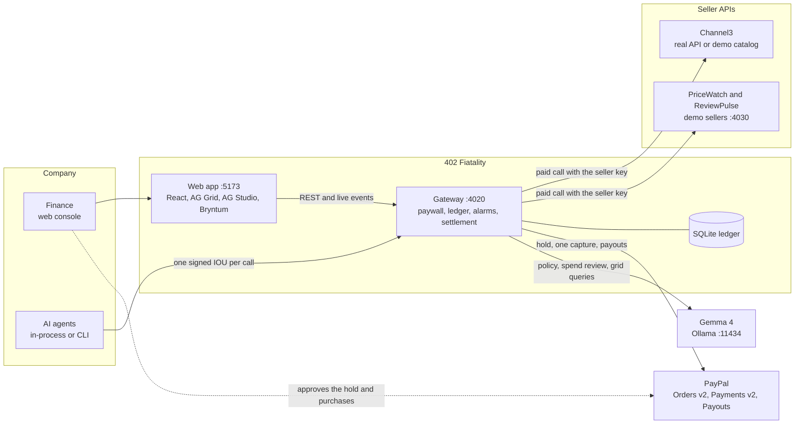
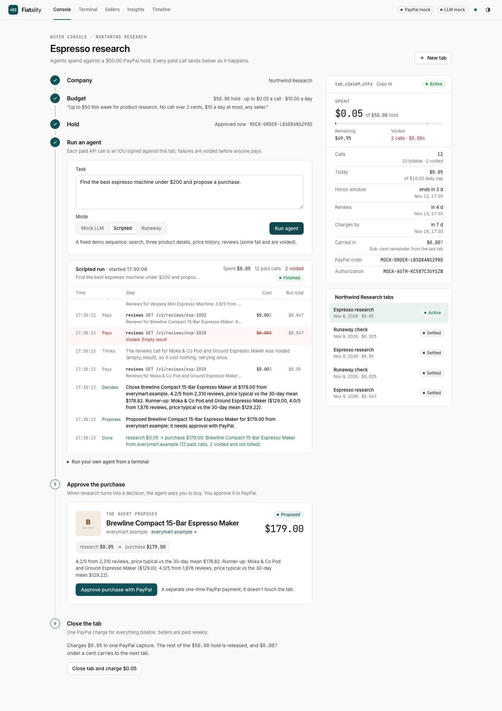
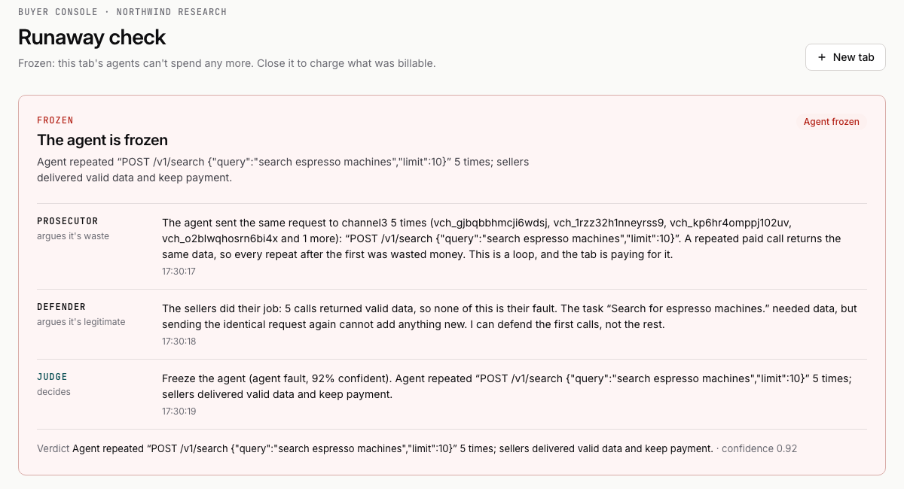
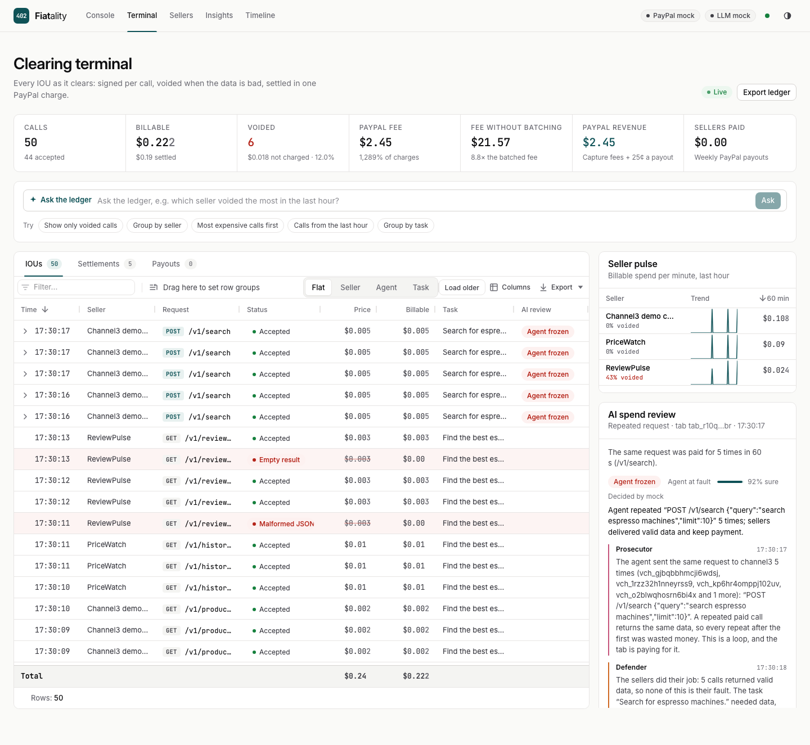

# 402 Fiatality

```
HTTP/1.1 402 Fiatality
```

**Agents pay per call. Finance pays once.**

402 Fiatality brings HTTP 402 micropayments for AI agents to PayPal. A company approves one PayPal hold, its agents sign an IOU for every paid API call, a gateway checks each IOU locally and voids bad responses before anyone is charged, and the whole tab settles as one PayPal charge. Sellers are paid out in PayPal Payouts batches.

Built for the PayPal AI Hackathon on Devpost, 2026. It runs fully offline in mock mode with no keys, or against the PayPal sandbox with Gemma 4 running locally on a Mac.



[Why](#why) · [How it works](#how-it-works) · [Architecture](#architecture) · [Quick start](#quick-start-on-a-mac) · [Mock vs sandbox](#mock-vs-sandbox) · [Sponsors and tech](#sponsors-and-technology) · [AI model](#ai-model-gemma-4) · [Demo script](#demo-script) · [Commands](#commands) · [Testing](#testing) · [Security](#security) · [Known limitations](#known-limitations)

## Why

Agents buy data one call at a time, often for less than a cent. PayPal can't take those payments one by one:

- **Two decimals.** PayPal amounts stop at the cent, so a $0.005 API call can't be charged at all (PayPal answers `DECIMAL_PRECISION`).
- **Per-payment fees.** US PayPal Checkout costs 3.49% + $0.49 per payment. The fixed part alone is almost ten times the price of a 5-cent call.

| 1,000 API calls worth $50 | What PayPal sees | PayPal fees | Fee rate |
|---|---|---:|---:|
| Paid one by one | 1,000 payments | $491.75 | 983.5% |
| On one 402 Fiatality tab | 1 payment of $50.00 | $2.24 | 4.48% |

The figures come from the same fee functions the ledger uses (`packages/shared/src/money.ts`). On a $50 tab a seller keeps about 95% after its share of PayPal's fee and the $0.25 payout fee. PayPal, meanwhile, earns on agent spending it sees none of today.

## How it works

1. **One hold per tab.** Finance describes a budget in plain English, Gemma 4 drafts the policy (hold, per-call maximum, daily cap, allowed sellers, rate limit, tab length), and approving it places one PayPal hold: an Orders v2 `AUTHORIZE` order, $50 by default. A company has one open tab at a time, shared by all its agents.
2. **A signed IOU per paid call.** Agents call seller APIs through the gateway at `/s/<seller>/...` using the x402 v2 headers. Each call carries an Ed25519-signed voucher bound to that exact request, with a per-seller sequence number and running total. The gateway verifies it locally, so paying adds no PayPal round trip.
3. **Bad responses are voided before anyone pays.** Each seller publishes void rules: server errors, rejected requests, timeouts, empty results, malformed JSON, responses that miss a schema. Spend alarms (repeated requests, error streaks, call velocity, spend spikes) pause the tab and start a three-role AI spend review that resumes, voids the bad calls, freezes a runaway agent, or hands the decision to a human.
4. **One PayPal charge.** At $50 billable or on day 7, whichever comes first, the gateway captures the billable total, floored to the cent, with `final_capture`, and PayPal releases the rest of the hold. The sub-cent remainder carries into the company's next tab. PayPal's fee is split across the tab's sellers in proportion to what each earned.
5. **Seller payouts.** Sellers owed at least $10 are paid in one PayPal Payouts batch, minus the $0.25 Payouts fee. The intended cadence is weekly; in this build an operator runs the batch from the Sellers page.

The hold follows PayPal's authorization rules: honored for 3 days, reauthorized once on day 4 (which starts a new 3-day honor window), charged by day 7. A tab under $10 on day 4 skips the early renewal, reauthorizes on day 25 and is charged by day 28, inside the authorization's 29 days.

The wire protocol is specified in [docs/BINDING.md](docs/BINDING.md) (the x402 `batch-settlement` scheme bound to PayPal) and the system design in [docs/ARCHITECTURE.md](docs/ARCHITECTURE.md).

### How it compares

"Authorize once, settle later" for agents already exists, on stablecoins:

| | Settles on |
|---|---|
| Stripe + Tempo MPP sessions (March 2026) | On-chain escrow |
| Mastercard Agent Pay for Machines (early access, October 2026) | Vouchers settled later through BVNK on Base |
| Cloudflare Monetization Gateway | Stablecoins |
| **402 Fiatality** | **A PayPal hold** |

That means no wallet and no stablecoin for buyers or sellers, about 440 million existing PayPal accounts, bad responses voided before anything is captured, and a single charge on the company's PayPal account that PayPal's usual dispute process covers.

## Architecture



- **Gateway** (Fastify, Node): the x402 paywall, the voucher ledger in SQLite, policy limits, spend alarms and the AI review runner, PayPal holds, captures and payouts, the REST API and a WebSocket event stream.
- **Agents** pay through the paywall like any external client, whether they run inside the gateway (started from the console) or from a terminal with `npm run agent`.
- **Web app** (React 19, Vite): the buyer console, the AG Grid clearing terminal, the seller portal, AG Charts and AG Studio insights, and a Bryntum timeline of every hold.

See [docs/ARCHITECTURE.md](docs/ARCHITECTURE.md) for the request flow, the tab lifecycle, the data model and the security design.

### A quick tour

The console after a scripted agent run in mock mode: every paid call with its price, voided ReviewPulse calls that cost nothing, and the agent's purchase proposal waiting for approval.



A runaway agent repeated the same paid search; the loop alarm paused the tab and the spend review froze the agent (mock mode, where rules stand in for Gemma):



The clearing terminal on AG Grid Enterprise, with every IOU as it clears, "Ask the ledger", seller sparklines and the live review debate:



## Quick start on a Mac

You need macOS (Apple Silicon recommended for Gemma), Node.js 22.12 or newer and npm.

```bash
git clone https://github.com/EmoBanana/402-fiatality.git
cd 402-fiatality
npm install
cp .env.example .env
```

`.env.example` runs fully offline with no keys: mock PayPal, the mock model and the built-in demo catalog. Start everything and open **http://localhost:5173**:

```bash
npm run dev
```

Shell variables win over `.env`, so `PAYPAL_MODE=mock LLM_PROVIDER=mock CHANNEL3_API_KEY= npm run dev` gives an offline run whatever `.env` says.

`npm run dev` starts three processes:

| Process | Port | What it is |
|---|---|---|
| Gateway | 4020 | API, paywall `/s/...`, WebSocket `/ws`, PayPal return pages |
| Demo sellers | 4030 | Three seller APIs that only answer the gateway (they check an `x-api-key` the gateway injects) |
| Web app | 5173 | Vite dev server; proxies `/api`, `/s/`, `/ws` and `/paypal` to the gateway |

With `DEMO_MODE=1` (the default) the gateway seeds the "Northwind Research" company and the demo sellers, and enables a fast-forward demo clock. The SQLite database and a generated master key live in `data/`, which is gitignored.

| Demo seller | Endpoint | Price per call |
|---|---|---:|
| Channel3 demo catalog | `POST /v1/search` | $0.005 |
| | `GET /v1/products/:id` | $0.002 |
| PriceWatch | `GET /v1/history/:productId` (30-day price stats) | $0.01 |
| ReviewPulse | `GET /v1/reviews/:productId` | $0.003 |

ReviewPulse fails on purpose: with the default `FLAKY_RATE=0.3`, 15% of answers are HTTP 500, 10% are empty and 5% are malformed JSON, so voids show up in every demo. The catalog holds 40 fictional products: espresso machines, headphones, standing desks and running shoes.

### Add Gemma 4 with Ollama

Install Ollama from [ollama.com](https://ollama.com), then pull the model that fits your Mac:

```bash
ollama pull gemma4:12b          # 24 GB Macs (the code default)
ollama pull gemma4:e4b-it-qat   # 16 GB Macs
```

In `.env`:

```bash
LLM_PROVIDER=ollama
LLM_BASE_URL=http://localhost:11434
LLM_MODEL=gemma4:e4b-it-qat     # or gemma4:12b
```

Run `npm run check:llm` to check the model end to end. On a slow or memory-starved Mac, raise `LLM_REVIEW_BUDGET_MS` (default 45000), the time one spend review may take before it escalates to a human. Any OpenAI-compatible server also works with `LLM_PROVIDER=openai`, `LLM_BASE_URL` and `LLM_API_KEY`.

## Mock vs sandbox

| | Mock (`PAYPAL_MODE=mock`) | Sandbox (`PAYPAL_MODE=sandbox`) |
|---|---|---|
| Keys | None | Sandbox REST app client ID and secret |
| Approving a hold or purchase | The gateway's "Mock PayPal (offline demo)" page | PayPal's sandbox approval page, signed in as a sandbox personal account |
| Authorization rules | Simulated: 3-day honor window, 29-day expiry, one reauthorization after the honor window, captures capped at 115% of the hold or +$75, whichever is less | PayPal's |
| Capture fee | Published US rate, 3.49% + $0.49 | `paypal_fee` from PayPal's `seller_receivable_breakdown` |
| Payouts | Succeed at once, $0.25 fee per item | A real Payouts batch, polled until final |
| Demo clock fast-forward | Simulates every step | The planned reauthorization is skipped while PayPal's real 3-day honor window is open; the charge uses the original authorization |

`LLM_PROVIDER=mock` swaps every AI feature for deterministic rules (policy parser, built-in shopping planner, rule-based spend review, rule-based grid queries), so tests and judges never need a model. With `CHANNEL3_API_KEY` set, the `channel3` seller points at the real Channel3 API instead of the demo catalog.

### Sandbox setup

1. At developer.paypal.com, open Apps & Credentials, create a sandbox REST app and put its credentials in `.env`:

   ```bash
   PAYPAL_MODE=sandbox
   PAYPAL_CLIENT_ID=...
   PAYPAL_CLIENT_SECRET=...
   ```

2. Enable **Payouts** for that app (your app → Features). Without it holds and captures work but payouts are refused.
3. Under Testing Tools → Sandbox Accounts, note the **personal** (buyer) account. You approve every hold and purchase with it.
4. Optional: set `SELLER_PAYPAL_EMAIL_CHANNEL3`, `SELLER_PAYPAL_EMAIL_PRICEWATCH` and `SELLER_PAYPAL_EMAIL_REVIEWS` to sandbox personal account emails to see payouts land. Left blank, the demo sellers get placeholder addresses (`<seller>@sellers.402fiatality.example`) that PayPal marks unclaimed.
5. Run `npm run check:paypal`. It creates a $5.00 hold and prints the approval link, then polls for up to 30 minutes while you approve it with the sandbox personal account. It then authorizes, captures $1.23 with `final_capture`, checks that the rest of the hold was released, sends a $0.50 payout to `SELLER_PAYPAL_EMAIL_CHANNEL3` (skipped when unset), and prints a pass/fail table with PayPal `debug_id`s. It also reports whether the app's token has the Payouts scope and whether partial capture is enabled on the account. It uses the sandbox credentials whatever `PAYPAL_MODE` says.
6. Run `npm run check:llm` if you use Gemma, then `npm run dev`.

Tip: point sandbox runs at their own database, for example `DATA_DIR=data/sandbox`, so tabs held on the mock never reach the real API.

## Sponsors and technology

Only what the code uses:

| Technology | Where | What it does here |
|---|---|---|
| **PayPal Server SDK** (`@paypal/paypal-server-sdk` 2.5) | `packages/gateway/src/paypal/sandbox.ts` | Orders v2: create the `AUTHORIZE` hold order and the `CAPTURE` purchase order, get, authorize, capture. Payments v2: get, reauthorize, capture an authorization with `final_capture`, void. `PayPal-Request-Id` on every call that moves money. |
| **PayPal Payouts** (REST, OAuth 2.0 client credentials) | same file | `POST /v1/payments/payouts` and `GET /v1/payments/payouts/{id}`. Payouts aren't in the Server SDK, so they are plain REST with the same cached token. |
| **AG Grid Enterprise** 36, with the **AI Toolkit** | `packages/web/src/features/terminal` | The clearing terminal: live transactions, row grouping with sums, set filters, master/detail review transcripts, sparklines, CSV and Excel export, and "Ask the ledger", which turns a question into grid state through Gemma. |
| **AG Charts** 14 | `packages/web/src/features/insights/charts` | Spend by seller, voids by reason, fee rate by tab size, per-call vs batched fees. |
| **AG Studio** 3 | `packages/web/src/features/insights/studio` | "Explore the ledger": a dashboard over calls, tabs and settlements whose AI assistant runs on Gemma through the gateway's chat proxy. |
| **Bryntum Scheduler** 8 | `packages/web/src/features/timeline` | Every tab's hold on one schedule: honor windows, reauthorization, the charge, payouts. Drag a planned charge to reschedule it. |
| **Channel3** product API | `packages/sellers/src/demoSellers.ts` | The product data the shopping agent pays for (`POST /v1/search`, `GET /v1/products/:id`) when `CHANNEL3_API_KEY` is set. The offline demo catalog has the same shape. |
| **Google Gemma 4** via **Ollama** | `packages/ai` | Policy drafting, the shopping agent, the spend review, grid queries and the AG Studio assistant (next section). |

Also: Fastify 5, better-sqlite3, zod 4, ajv, pino, React 19, React Router 7, Vite 8, Vitest 5 and TypeScript 5.9 run through tsx. The AG Grid, AG Studio and Bryntum license keys are optional `VITE_*` values in `.env`; without them those components run as watermarked trials.

## AI model: Gemma 4

The model is **Google Gemma 4**, run locally through **Ollama**. `gemma4:12b` is the code default and suits 24 GB Macs; on 16 GB Macs use `gemma4:e4b-it-qat` by setting `LLM_MODEL`. Requests use Ollama's native chat API with thinking off, structured output through a JSON Schema `format`, an 8,192-token context and `keep_alive` of 15 minutes. The gateway loads the model at startup so the first review doesn't spend its budget on a cold start.

What Gemma does:

- **Drafts the policy** from plain English (`POST /api/policy/parse`). The model answers in dollars with nulls for anything not mentioned; a rule-based parse fills the gaps and fixes cents-for-dollars slips; the result is clamped and validated. If the model fails, the rule-based parser answers and the console says so.
- **Runs the shopping agent** (mode "Gemma 4"). Each step is one JSON action (`search`, `details`, `price_history`, `reviews`, `propose_purchase` or `finish`), and every paid call needs a one-line value-of-information reason ("is this worth $0.005?"). Actions are checked before anything is paid: known product ids, no repeated calls, a research budget of $0.25 by default. After three rejected replies in a row the built-in planner takes that step, and after two failed model calls in a row it takes over the rest of the run, so every run ends in a decision.
- **Reviews spending** when an alarm pauses a tab: a prosecutor, a defender and a judge, in that order, streamed live. The judge returns `{verdict, fault, confidence, reason, voidVoucherIds}`. Needless spending is agent fault and freezes the agent (sellers keep payment for good data); bad data is seller fault and voids only those calls. Request and response excerpts are fenced as untrusted `<evidence>`, the facts come from the ledger, and a ruling below 0.6 confidence, an inconsistent ruling, an error or running past the review budget (45 s by default) escalates to a human.
- **Answers "Ask the ledger"** in the terminal: the AG Grid AI Toolkit sends the question, the grid's structured schema and its current state; Gemma returns a plan limited to the grid's real columns, applied with `setState`.
- **Powers the AG Studio assistant** on the Insights page through an OpenAI-style chat proxy (`POST /api/ai/chat`) that maps tool calls to Ollama.

Measured on a 16 GB Apple Silicon Mac:

| Model | Memory when loaded | `npm run check:llm` (6 steps) | Three-role spend review |
|---|---|---|---|
| `gemma4:12b` | about 11 GB; pushes a 16 GB Mac deep into swap | passed* | about 33 s |
| `gemma4:e4b-it-qat` | about 5.6 GB | all steps pass in about 25 s | about 11 s |

Drafting a policy through the gateway took about 10 s. Gemma 4 12B on a busy 16 GB Mac writes about 5 to 7 tokens a second, which is why each review argument is asked for in 35 words or fewer.

\* `gemma4:12b` passed on November 9, 2026, before a later change to the review prompt; `gemma4:e4b-it-qat` passed on the final prompts.

## Demo script

About three minutes. Works in mock mode as is; in sandbox mode the PayPal steps happen on PayPal's sandbox pages.

1. **The problem.** On the landing page, "The math": a $0.005 call can't be charged on PayPal, and 1,000 calls paid one by one cost $491.75 in fees against $2.24 for one $50 tab.
2. **Open a tab.** Click **Open console**. Step 1, Company: Northwind Research is preselected. Step 2, Budget: pick an example or type one ("Up to $50 this week for product research. No call over 2 cents, $10 a day at most, any seller.") and click **Draft policy**. Gemma drafts an editable policy card with a plain-English summary. Step 3, Hold: click **Approve hold with PayPal**. In the popup, sign in with the sandbox personal account and approve (in mock mode, click **Approve hold** on the mock page). The popup closes and the tab card shows the hold, the honor window, the renewal and the charge date.
3. **Run the agent.** Open **Terminal** in a second window. In step 4, Run an agent, choose mode **Gemma 4** (shown as "Mock LLM" when `LLM_PROVIDER=mock`; **Scripted** needs no model) and click **Run agent**. The feed shows each paid call with its price and the agent's reason; the terminal fills live; flaky ReviewPulse calls void in red with their reason, such as Empty result, Malformed JSON or Seller error (5xx), and cost nothing. Watch "PayPal fee" against "Fee without batching" in the stat strip.
4. **The proposal.** The run ends in step 5, Approve the purchase, with a card like "research $0.05 → purchase $179.00". Leave it for the finale.
5. **A runaway agent.** Choose **Runaway** and click **Run agent**. It repeats the same paid search; after 5 identical paid requests within 60 seconds (the default loop rule) the alarm pauses the tab, the review banner streams the prosecutor, the defender and the judge, and the verdict freezes the agent with a reason.
6. **One charge.** Step 6, Close the tab: click **Close tab and charge $X**, then confirm. The card reads "Settled with one PayPal charge": one capture with `final_capture`, the rest of the hold released, PayPal's fee split across sellers, the sub-cent remainder carried to the next tab. Click **View statement** for the printable statement.
7. **Seller payouts.** On **Sellers**, click **Run payouts** (in demo mode you can lower the threshold to $1.00 or $0.10). Every seller owed at least the threshold is paid in one PayPal batch, minus $0.25 each. After a tab of only a few cents, sellers can still be below zero because PayPal's fee has a fixed $0.49 part (see [Known limitations](#known-limitations)), and the button says nobody is owed enough yet.
8. **The finale.** Back on the tab, click **Approve purchase with PayPal**. It is a separate one-time PayPal payment for the product, not part of the tab; the card then shows "Purchased through PayPal" next to the research cost.
9. **Optional: the calendar.** On **Timeline**, click **+1 day** to fast-forward the demo clock and watch the scheduler renew and charge holds, or drag a planned charge to move it.

Close on the tagline, and name the model: Gemma 4 via Ollama.

## Commands

| Command | What it does |
|---|---|
| `npm run dev` | Gateway, demo sellers and web app with file watching |
| `npm test` | All tests (Vitest), fully offline |
| `npm run typecheck` | `tsc` in every package |
| `npm run check:paypal` | Sandbox money-path check: hold, approval, partial capture with `final_capture`, release, payout |
| `npm run check:llm` | Model check: health, JSON output, policy parse, spend review, grid query, chat proxy, with timings |
| `npm run agent -- --help` | Run the shopping agent from a terminal against a tab (`--tab`, `--token`, `--task`, `--mode llm\|scripted\|runaway`) |
| `npm start` | Builds the web app and serves it from the gateway on :4020, with the demo sellers. Set `WEB_BASE_URL=http://localhost:4020` so PayPal's return page links back there. |
| `npm run build` | Builds the web app only |

The console shows the exact `npm run agent` command for a tab, with its enroll token, under "Run your own agent from a terminal".

## Project layout

```
packages/
  shared/    Contracts: money math, x402 types, Ed25519 vouchers, request hash, DTOs, events
  gateway/   Fastify server: paywall, ledger, policy, alarms, AI review runner, PayPal and settlement, REST, /ws
  ai/        Gemma 4 client (Ollama, OpenAI-compatible, offline mock), policy parser, spend review, grid queries, chat proxy
  agent/     x402 client, the shopping agent (llm, scripted, runaway) and its CLI
  sellers/   Demo seller APIs: Channel3-shaped catalog, PriceWatch, ReviewPulse
  web/       React 19 + Vite dashboard: landing, console, terminal, sellers, insights, timeline, statements
docs/        SPEC.md (blueprint), BINDING.md, ARCHITECTURE.md, PROGRESS.md
```

Node packages run TypeScript directly through tsx; only the web app has a build step.

## Testing

`npm test` runs **340 tests in 29 files**, offline: in-memory SQLite, mock PayPal, the mock LLM, and fake sellers and LLM servers on local ports.

| Package | Tests | Highlights |
|---|---:|---|
| gateway | 198 | The paywall verification matrix (every 402 reason), concurrent double-spend, quality guard rules, alarms and reviews, settlement math and ledger invariants, the scheduler (day 4, day 7, small tabs, expiry, sandbox honor window), payouts, mock PayPal rules, the sandbox client against fake PayPal responses, SSRF and admin-guard cases, an end-to-end run over real HTTP |
| ai | 90 | Policy parsing, structured output and retries, review decisions and prompt fencing, grid queries, the chat proxy |
| agent | 24 | x402 client: pay on first request, quotes, resync, pauses, foreign-origin refusal; all three agent modes |
| sellers | 13 | Demo seller behavior and listings |
| shared | 12 | Money math, fee functions, vouchers, request hash, header encoding |
| web | 3 | Formatting helpers |

`npm run check:paypal` and `npm run check:llm` cover the real services.

## Security

- Every paid call carries an Ed25519 signature over a voucher bound to the exact request (method, path, query and body hash), checked against the agent's registered key. Vouchers live at most 5 minutes, judged on wall-clock time.
- Each (tab, seller) channel accepts only the next sequence number and running total, checked and recorded in one SQLite transaction before the call is forwarded, with a UNIQUE index as a backstop. A replayed voucher is refused.
- Policy limits (sellers, per-call maximum, daily cap, hold, rate) count calls still in flight, so concurrent calls can't overspend.
- Enroll tokens are stored as SHA-256 and compared in constant time. Seller API keys are encrypted at rest with AES-256-GCM (seller id as associated data, full-length tags) and never returned.
- Seller URLs pass an SSRF guard at registration and again for every connection (every dialed address must be public; localhost only in demo mode). Only allow-listed headers are forwarded, responses are capped at 2 MB, and request paths can't escape the seller's base path.
- Every input is validated with zod and every SQL statement is parameterized. Helmet, CORS limited to the web origin, and a rate limit on `/api`. With `DEMO_MODE=0`, writes need the `x-p402-admin` header; in demo mode, browser writes are accepted only from the app's own or a localhost origin.
- The AI review treats request and response text as fenced, sanitized evidence, can only touch the tab's unsettled vouchers, and escalates to a human when unsure.
- Logs redact authorization headers, cookies, API keys, the admin token and `PAYMENT-SIGNATURE`. PayPal errors keep `debug_id` but never the outgoing request.

The checklist is in [SPEC §10](docs/SPEC.md#10-security-checklist) and the design, including the fixes from the security review, in [docs/ARCHITECTURE.md](docs/ARCHITECTURE.md#security-design).

## Known limitations

- **Tiny tabs can leave sellers a negative net.** PayPal's capture fee has a fixed $0.49 part, split across sellers pro rata, so closing a tab worth a few cents leaves its sellers below zero. Their balances recover from later earnings; payouts need real volume. This keeps the spec's fee math and was a deliberate choice.
- **Payouts are run by hand.** `POST /api/payouts/run` (the **Run payouts** button) pays everyone over the threshold; there is no automatic weekly job yet.
- **The demo clock vs PayPal's honor window.** The demo clock can jump days ahead; PayPal's sandbox can't, and it refuses a reauthorization inside the real 3-day honor window. In sandbox mode the scheduler skips the planned reauthorization while that window is open (the timeline still shows it), and the charge uses the original authorization. **Close tab and charge** captures at once.
- **Partial capture** of PayPal-wallet authorizations may need enabling on a sandbox merchant account. `npm run check:paypal` detects it.
- **Open security items** from the security review: `GET /paypal/cancel` is unauthenticated and its `ref` and `token` are readable from `/api/tabs`, so anyone who can reach the gateway can cancel a pending hold approval; a new hold that cancels a tab while its authorization is in flight can leave a PayPal authorization open; seller response schemas may contain slow regular expressions. Demo mode refuses writes from browser origins other than the app or localhost, so LAN access needs `WEB_BASE_URL` set to that origin.
- **Demo mode has no admin token.** Keep `DEMO_MODE=1` on localhost; anywhere else set `DEMO_MODE=0` and `ADMIN_TOKEN`.
- **One gateway process per database.** Per-tab locks are in memory; across processes the voucher UNIQUE index and PayPal-Request-Id idempotency are the only guards.

## License

[MIT](LICENSE)
