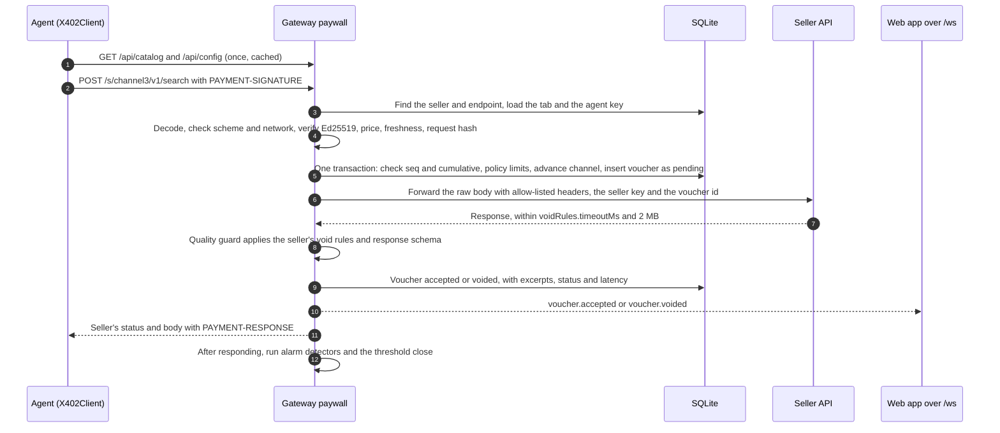
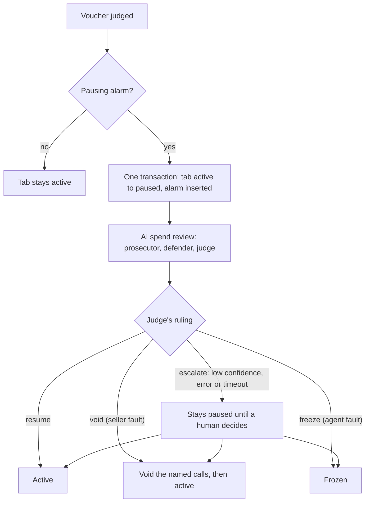
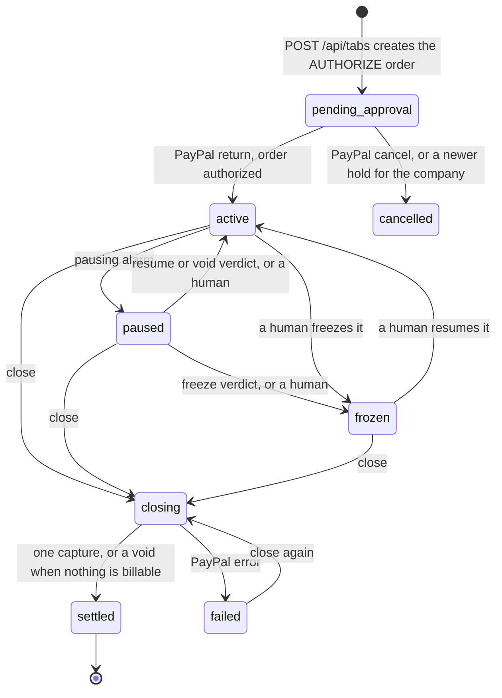

# Architecture

402 Fiatality is a TypeScript monorepo (npm workspaces, ESM, Node 22.12 or newer). A Fastify gateway owns the money: it serves the x402 paywall, keeps the voucher ledger in SQLite, enforces each tab's policy, raises spend alarms and runs the AI review, and talks to PayPal. A React app shows it all live over a WebSocket. Node packages run their TypeScript source directly through tsx; only the web app is built.

This document is for technical reviewers. The wire protocol is in [BINDING.md](BINDING.md); the original blueprint is [SPEC.md](SPEC.md).

## Packages

| Package | Owns | Main modules |
|---|---|---|
| `packages/shared` | The contracts every package uses: money math in integer micro-dollars and PayPal's fee functions, the x402 types, Ed25519 vouchers and the request hash, policies and void rules with their zod schemas, REST DTOs, event types. Node-only code (signing, header encoding) sits behind a separate entry point so the browser never loads it. | `money.ts`, `x402.ts`, `voucher.ts`, `headers.ts`, `policy.ts`, `voidRules.ts`, `api.ts`, `events.ts` |
| `packages/gateway` | The server: configuration, the dependency-injection context, the SQLite ledger, the event bus and `/ws`, the seller registry, the paywall, alarms, the review runner, in-process agent runs, both PayPal clients, settlement, the REST API, metrics. | `src/config.ts`, `context.ts`, `services.ts`, `server.ts`, `core.ts`, `paywall/`, `sellers/`, `alarms/`, `review/`, `agents/`, `paypal/`, `settlement/`, `routes/`, `db/`, `events/`, `ws.ts` |
| `packages/ai` | LLM clients (Ollama, OpenAI-compatible, offline mock) behind one interface, and the AI service: policy parsing, the spend review, grid queries, the chat proxy. | `llm/`, `policy/`, `review/`, `grid/`, `chat/`, `service.ts`, `scripts/check-llm.ts` |
| `packages/agent` | The x402 client and the shopping agent (modes llm, scripted, runaway), plus its CLI. | `x402Client.ts`, `session.ts`, `modes/`, `planner.ts`, `prompt.ts`, `cli.ts` |
| `packages/sellers` | Three demo seller APIs on one Fastify server, and their listings for the gateway's seeder. | `app.ts`, `channel3.ts`, `pricewatch.ts`, `reviews.ts`, `catalog.ts`, `demoSellers.ts` |
| `packages/web` | The React 19 + Vite dashboard. | `pages/`, `features/`, `components/`, `lib/` |

Internally the packages are scoped `@p402/*`. Dependencies point one way:

- Every package uses `packages/shared`; the web app imports only its browser-safe entry.
- The gateway's contracts (`PaypalClient`, `SettlementService`, `AiService`, `LlmClient`, `RunAgent`, the demo-seller functions) live in `packages/gateway/src/context.ts`. The ai, agent and sellers packages implement them and import them as types only. They also reuse the gateway's config loader for their CLIs and servers.
- The gateway imports the ai, agent and sellers implementations in exactly one file, `src/services.ts`, the composition root. Everything else reaches them through the context, so tests swap in fakes.

## Processes and ports

| Process | Port | Started by |
|---|---|---|
| Gateway | 4020 | `npm run dev` (`tsx watch`), or `npm start`, which also serves the built web app |
| Demo sellers (`/channel3`, `/pricewatch`, `/reviews` on one server) | 4030 | `npm run dev`, `npm start` |
| Web app (Vite dev server) | 5173 | `npm run dev`; proxies `/api`, `/s/`, `/paypal` and `/ws` to the gateway |
| Ollama | 11434 | You, when `LLM_PROVIDER=ollama` |
| PayPal sandbox API | `api-m.sandbox.paypal.com` | Used when `PAYPAL_MODE=sandbox` |
| Channel3 API | `api.trychannel3.com` | Used when `CHANNEL3_API_KEY` is set |

## A paid call

The hot path makes no PayPal call. Verification and the reservation are synchronous (better-sqlite3), so nothing interleaves between checking a voucher's sequence number and recording it. The request body is kept as raw bytes: they are hashed for the voucher check and forwarded unchanged. Requests whose path tries to escape the seller's base path (dot segments, encoded slashes, backslashes) never match an endpoint. The full list of checks and their 402 reasons is in [BINDING.md, section 2](BINDING.md#2-verification-rules).

Agents started from the console run inside the gateway. Each run gets a fresh agent id and Ed25519 key pair; the public key is registered on the tab directly and the private key never leaves the process. The agent then pays through the public paywall over HTTP, exactly like an external agent started with `npm run agent`. At most three runs execute at once.

## Alarms, pause and AI review

After each judged voucher the gateway evaluates the tab's alarm rules from its policy:

| Alarm | Fires when (defaults) | Effect |
|---|---|---|
| `repeat_request` | The same request hash is paid for `repeatRequestThreshold` (5) times within `repeatWindowSec` (60 s) | Pause |
| `error_streak` | The last `errorStreak` (4) judged calls were all voided | Pause |
| `velocity` | Calls in the last minute reach 90% of `maxCallsPerMinute` (108 of 120) | Pause |
| `spend_spike` | Last-minute spend exceeds `spendSpikeMultiplier` (4) times the average per active minute of the 10 minutes before, given at least 3 active minutes in that baseline and at least $0.05 in the last minute | Pause |
| `budget_threshold` | Billable spend plus carry-in reaches `budgetWarnPct` (85%) of the hold | Notify only, once per tab |

Pausing detectors run in that priority order and only count calls made after the tab's previous pausing alarm, so the evidence behind one review can't trip the next alarm the moment the tab resumes.

**The review runner** (`src/review/runner.ts`) allows one running review per tab. It gathers the evidence (the tab with its policy and totals, the alarm, the agent's task from the run behind the latest call, and the last 25 judged vouchers with their request and response excerpts) and calls `ai.reviewSpend`. Each role's message is saved to the review's transcript and emitted as `review.message` as it arrives, which is what the console banner and the terminal panel stream.

**In the AI service** (`packages/ai/src/review/`), the prosecutor and the defender each get the same two-part context, then their own turn, and are asked for at most 35 words. The judge answers in a JSON schema: verdict, fault, confidence, reason, voucher ids to void. Facts computed from the ledger (totals, limits, the most repeated request, seller failures) are marked trusted. Everything that came from agents or sellers sits inside an `<evidence>` block, flattened to single lines with angle brackets replaced, and the system prompt says it is never an instruction. The ruling is then checked: ids must come from the evidence; `void` must name at least one and mean seller fault; `freeze` means agent fault; a contradiction, confidence below 0.6, a model error or running out of the budget (`LLM_REVIEW_BUDGET_MS`, 45 s by default) becomes `escalate`. With `LLM_PROVIDER=mock`, deterministic rules play all three roles: loops and runaway pace freeze, seller failures behind an error streak are voided, anything else resumes.

**Applying the verdict** happens in one transaction with the review's final state:

- `resume`: the tab goes back to `active`.
- `void`: the named vouchers are voided with reason `ai_review` (only those of this tab that are accepted and not yet settled), then the tab resumes.
- `freeze`: the tab is `frozen`. Sellers keep payment for the calls they served well.
- `escalate`: the tab stays paused, the alarm stays open, and the AI's suggested voids are remembered for the human.

A human decides with `POST /api/reviews/{id}/decide` (`resume`, `void` or `freeze`), or with `POST /api/tabs/{id}/resume` and `/freeze`, which settle the pending review if there is one. While the tab is paused, agents get `402 tab_paused` with `Retry-After` of 5 s while the review runs and 30 s once it waits for a human. A review cut off by a shutdown or a crash is escalated to a human.

## Tab lifecycle and the settlement scheduler

**Opening.** `POST /api/tabs` validates the policy, refuses a second open tab for the company (`409 tab_already_open`), creates the Orders v2 `AUTHORIZE` order (one purchase unit for the hold, `reference_id` and `custom_id` = tab id, description "Agent spending tab", soft descriptor "FIATALITY AGENT TAB", brand name "402 Fiatality", user action `CONTINUE`, no shipping) and stores the tab as `pending_approval` with a hashed enroll token and the company's carried remainder. Older unapproved tabs of the company are cancelled. The console opens PayPal's approval link in a popup.

**Approval.** PayPal redirects the popup to `GET /paypal/return?kind=tab&ref=<tab>&token=<order>`. The gateway checks that the token is the tab's own order, authorizes it, and sets `honor_until` (+3 days), `expires_at` (PayPal's `expiration_time`, or +29 days), `reauthorize_at` (+4 days) and `close_at` (+`closeAfterDays`). It answers with a small page under a strict nonce-based CSP that posts a message to the opener and closes itself. PayPal's pages can cut the popup off from its opener, so the console also treats the `tab.updated` event as the source of truth. `GET /paypal/cancel` cancels a tab that was never approved. Both are idempotent.

**The scheduler** (`src/settlement/scheduler.ts`) runs every 30 s, a second after start, and right after `POST /api/clock/advance`; runs never overlap. For each tab that is `active`, `paused`, `frozen` or `closing`, in order:

1. A tab left in `closing` by a crash: resume its pending settlement.
2. Billable spend plus carry-in at or above `closeAtCents` ($50): close it (threshold).
3. Within an hour of the authorization's expiry: close it (expiring).
4. Reauthorization due and not done yet:
   - a small tab (under `smallTabMinCents`, $10) on its day-4 slot: move the reauthorization to day 25 and the charge to day 28, then look again;
   - otherwise, unless the charge is due anyway: reauthorize for the hold amount, store the new authorization id and a new 3-day honor window.
5. `close_at` reached: close it (scheduled).

Then it refreshes payouts that PayPal is still processing. Accepted calls that bring a tab to its threshold also trigger a close immediately, without waiting for the next run.

In sandbox mode the scheduler remembers the real time of each authorization and does not ask PayPal to reauthorize until 3 real days have passed, because PayPal refuses a reauthorization inside the honor window and the demo clock may be days ahead. A failed reauthorization is retried at most hourly. Either way the tab keeps its original authorization and is charged on schedule.

**Closing** (`src/settlement/close.ts`) takes a per-tab lock, sets `closing`, waits for calls in flight (up to the longest seller timeout plus 1 s), voids whatever is still pending, and records a pending settlement with the floored charge and the sub-cent carry. Outside any transaction it captures once with `final_capture` (or voids the hold when the charge is $0) and voids any remainder PayPal still shows. A final transaction writes the per-seller lines with the pro-rata fee split, credits seller balances, settles the tab and parks the carry for the company's next tab. On a PayPal failure the tab becomes `failed` with its vouchers unsettled, and closing again retries with the same `PayPal-Request-Id`. The exact algorithm and a worked example are in [BINDING.md, section 6](BINDING.md#6-redemption).

**Payouts** (`src/settlement/payouts.ts`) run on `POST /api/payouts/run`, the Sellers page's "Run payouts" button. Sellers owed at least the threshold ($10 by default; the demo UI offers $1 and $0.10) are debited before PayPal is called, paid in one Payouts batch whose `sender_batch_id` is the payout id, and given their money back for any item PayPal fails. There is no automatic weekly job yet.

**Purchases** (`src/settlement/purchases.ts`) are separate from the tab. The agent files a proposal with `POST /api/purchases` (title, price, merchant, product link, image, research cost, reasoning). "Approve purchase with PayPal" calls `POST /api/purchases/{id}/checkout`, which creates an Orders v2 `CAPTURE` order with one item and user action `PAY_NOW`. After approval, `/paypal/return?kind=purchase` captures it and the purchase becomes `captured`.

**Every PayPal call that moves money** sends a `PayPal-Request-Id` derived from our own ids (`hold-<tab>`, `authorize-<tab>`, `reauth-<tab>`, `capture-<settlement>`, `void-rest-<settlement>`, `checkout-<purchase>`, the payout id), so retries are idempotent. Failures become a typed `PaypalError` (HTTP 502 `paypal_error`) carrying PayPal's error name, `debug_id` and issues.

**PayPal clients** (`src/paypal/`): the sandbox client uses the Server SDK's `OrdersController` and `PaymentsController` with `Prefer: return=representation` (so captures report `seller_receivable_breakdown.paypal_fee`), and plain REST for Payouts. One OAuth token cache serves both, and the client secret lives only inside that cache's closure. The mock client implements the same interface offline and keeps its orders, authorizations, captures and batches in the `kv` table so they survive restarts. It enforces PayPal's rules: approval before authorization, one reauthorization after the honor window, expiry at 29 days, captures capped at 115% of the hold or +$75 (whichever is less), duplicate invoice ids rejected, and repeated request ids answered with the first result.

## Data model

SQLite through better-sqlite3, one file (`data/p402.sqlite` by default) in WAL mode with foreign keys on. Money columns are integer micro-dollars unless the name ends in `_cents`; times are epoch milliseconds on the gateway clock. Every multi-row write runs in a transaction and every statement is parameterized and cached per connection. The schema (`src/db/schema.sql`) is versioned with `PRAGMA user_version`; a database from another version is refused with instructions to delete it, since `data/` only holds demo data.

| Table | Holds | Notes |
|---|---|---|
| `companies` | Buyer companies | The demo seeds "Northwind Research". |
| `sellers` | Listings: base URL, auth header, encrypted API key, PayPal email, void rules, status | Keys are AES-256-GCM, `iv.tag.ciphertext`, never returned. |
| `endpoints` | Method, path pattern, price, description, optional response schema | `UNIQUE (seller_id, method, path)`; never deleted, because vouchers reference them. |
| `tabs` | Status, policy and its plain-English source, hold, enroll token hash, PayPal order and authorization ids, approval link, `authorized_at`, `honor_until`, `expires_at`, `reauthorize_at`, `reauthorized_at`, reauthorization id, `close_at`, `carry_in_micros` | One open tab per company. |
| `agent_keys` | Ed25519 public key per (tab, agent) | |
| `channels` | `last_seq` and `last_cumulative_micros` per (tab, seller) | The double-spend state. |
| `vouchers` | One row per paid call: sequence, price, cumulative, request hash, method, path, agent, task, status, void reason, HTTP status, latency, size, request and response excerpts, the signed header as received, review id, settlement id | `UNIQUE (tab_id, seller_id, seq)`; indexed by tab and time, by seller and settlement, and by tab and request hash for the loop detector. |
| `alarms` | Kind, message, detail, status (`open`, `reviewing`, `resolved`) | |
| `reviews` | Status, verdict, fault, confidence, reason, voided ids, transcript, model, decided by AI or human | |
| `settlements` | Billable, charged cents, carry-out, PayPal fee, capture id, the fee per-call payments would have cost, call and void counts | |
| `settlement_lines` | Per seller: gross, fee share, net, calls | Sum of net plus fee share = charged cents x 10,000. |
| `seller_balances` | Available and paid-out micro-dollars | Available can go below zero after tiny tabs. |
| `payouts`, `payout_items` | Batches and their items, with PayPal batch and item ids and statuses | |
| `purchases` | Agent proposals and their PayPal order, approval link, capture id, research cost | |
| `agent_runs`, `agent_steps` | Each in-process run and every step it reported | |
| `events_log` | Append-only audit of every event except metrics snapshots | |
| `kv` | Small state: the demo clock offset, each company's pending carry, the key-vault fingerprint, the real authorization time and reauthorization back-off per tab, an escalated review's suggested voids, and the mock PayPal's records | |

A voucher is `pending` only while its call is in flight: it counts toward limits but is never billable, listed or emitted, and any left over from a crash are voided at startup. Reviews interrupted by a restart are escalated to a human and interrupted agent runs are marked failed.

## Events and the WebSocket

`src/events/bus.ts` is a typed in-process emitter for the `GatewayEvent` union in `packages/shared/src/events.ts`. Every emit is stamped with the gateway clock, appended to `events_log` (except `metrics`) and delivered to subscribers synchronously.

| Event | Emitted when |
|---|---|
| `voucher.accepted`, `voucher.voided` | A paid call is judged; `voucher.voided` also when a review voids an accepted call |
| `tab.updated` | Any change to a tab: created, approved, cancelled, paused, resumed, frozen, reauthorized, rescheduled, closing, settled, failed |
| `alarm.raised` | A detector fires |
| `review.started`, `review.message`, `review.finished` | The AI spend review, one message per role |
| `settlement.completed` | A tab settles |
| `payout.completed` | A payout batch reaches a final state |
| `seller.updated` | A listing, status, price or balance changes |
| `agent.step`, `agent.finished` | In-process agent runs |
| `purchase.updated` | A proposal, checkout, capture or cancellation |
| `clock.advanced` | The demo clock moved |
| `metrics` | A summary of calls, billable, voids, fees, payouts, open alarms |

`/ws` (`src/ws.ts`) accepts browsers only from the web app's origin, the gateway's own, or localhost in demo mode. Each event is serialized once and sent to every socket. A `metrics` snapshot goes out on connect, then at most once a second and only when something changed. A client more than 4 MB behind is dropped rather than buffered without bound, and inbound messages are capped at 4 KB.

## The web app

| Route | Page | Built on |
|---|---|---|
| `/` | Landing: the hero as an `HTTP/1.1 402 Fiatality` response line with an IOU tape, how it works, the fee math, a section for sellers, the stack | Plain React and CSS; figures come from the shared fee functions |
| `/console` | Buyer console: 1 Company, 2 Budget ("Draft policy", editable policy card), 3 Hold ("Approve hold with PayPal"), 4 Run an agent (modes Gemma 4, Scripted, Runaway), 5 Approve the purchase, 6 Close the tab; a live tab card, the review banner, and the CLI command for running your own agent. `?tab=<id>` selects a tab. | |
| `/terminal` | Clearing terminal: stat strip, "Ask the ledger", the live IOU grid, settlements and payouts grids, seller pulse sparklines, the AI review panel and alarms, one-click Excel export of all three grids | AG Grid Enterprise with the AI Toolkit |
| `/sellers` | Seller portal: totals, seller cards with prices, balances and void rates, "List your API", payouts and their history | |
| `/insights` | Spend by seller and voids by reason over a chosen range; fee rate by tab size and per-call vs batched fees; "Explore the ledger" in AG Studio with its AI assistant on Gemma | AG Charts, AG Studio |
| `/timeline` | Every tab's hold on one schedule against the demo clock, with drag-to-reschedule and a "+1 day" fast-forward in demo mode | Bryntum Scheduler |
| `/statements/:tabId` | A printable statement | |

Each page is a lazily loaded route, so AG Grid, AG Studio and Bryntum load only with the pages that use them. The data layer lives in `src/lib`:

- `api.ts`: a typed client for every route, throwing `ApiError` (status 0 means the gateway is down). Writes send the admin header when an admin token is stored in the browser; the demo needs none.
- `events.ts`: one shared WebSocket with automatic reconnect, and hooks to subscribe by event type, read the latest event of a type, and refetch after a reconnect (missed events are not replayed).
- `resource.ts`: loading and error state with abort on unmount; live events patch the loaded data in place.
- `config.ts`: `/api/config` and `/api/health`, fetched once and shared; the header's PayPal-mode and model badges come from here.
- `paypal.ts`: opens the PayPal popup inside the click handler so browsers don't block it, then listens for the return page's message from the gateway's origin only.
- `format.ts`: money and time formatting, re-exporting the shared money functions.

The terminal never routes vouchers through React state: they go straight into AG Grid with `applyTransactionAsync`, batched and deduplicated by id. "Ask the ledger" sends `getStructuredSchema()` and `getState()` to `POST /api/ai/grid-query` and applies only the filter, sort, grouping, aggregation and column-visibility sections of the answer, with column ids checked first.

The design system (`src/styles/tokens.css`, `src/components`) uses CSS variables for light and dark themes, Inter and JetBrains Mono, hairline borders and one petrol accent. It deliberately uses no PayPal logo or brand colors; PayPal's own pages are used only for approvals. License keys for AG Grid, AG Studio and Bryntum are optional `VITE_*` values read from the repo's `.env`.

## Configuration and the composition root

`src/config.ts` loads the root `.env` with Node's `process.loadEnvFile` (variables already in the shell win) and validates it with zod. Errors name the bad keys, never their values. Sandbox mode without PayPal credentials, or `DEMO_MODE=0` without `ADMIN_TOKEN`, refuses to start.

| Variable | Default | Purpose |
|---|---|---|
| `PAYPAL_MODE` | `mock` | `mock` or `sandbox` |
| `PAYPAL_CLIENT_ID`, `PAYPAL_CLIENT_SECRET` | | Sandbox REST app credentials |
| `LLM_PROVIDER` | `mock` (also in `.env.example`) | `ollama`, `openai` or `mock` |
| `LLM_BASE_URL` | `http://localhost:11434` (`https://api.openai.com` for `openai`) | Model server |
| `LLM_MODEL` | `gemma4:12b` | Model tag |
| `LLM_API_KEY` | | For OpenAI-compatible servers |
| `LLM_REVIEW_BUDGET_MS` | `45000` | Time for one spend review before it escalates (5,000 to 600,000) |
| `CHANNEL3_API_KEY` | | Seeds the real Channel3 API instead of the demo catalog |
| `SELLER_PAYPAL_EMAIL_CHANNEL3`, `_PRICEWATCH`, `_REVIEWS` | Placeholder addresses | Payout receivers for the demo sellers |
| `MASTER_KEY` | Generated into `DATA_DIR/master.key` | 32 bytes, hex or base64, for the seller key vault |
| `DATA_DIR` | `data` | SQLite file and master key, relative to the repo root |
| `PORT`, `SELLERS_PORT`, `HOST` | `4020`, `4030`, `localhost` | Listening |
| `PUBLIC_BASE_URL` | `http://localhost:<PORT>` | The gateway's origin: paywall URLs and PayPal return URLs |
| `WEB_BASE_URL` | `http://localhost:5173` | The web app's origin: CORS, allowed browser origin, the return page's fallback link |
| `SELLERS_BASE_URL` | `http://localhost:<SELLERS_PORT>` | Where the demo sellers are seeded |
| `DEMO_MODE` | on | Seeds demo data, enables the demo clock and rescheduling, allows localhost sellers, needs no admin token |
| `ADMIN_TOKEN` | | Required `x-p402-admin` value for writes when `DEMO_MODE=0` |
| `FLAKY_RATE` | `0.3` | Share of flaky ReviewPulse answers |
| `LOG_LEVEL`, `NODE_ENV` | `info`, `development` | `NODE_ENV=production` serves `packages/web/dist` |
| `VITE_AG_GRID_LICENSE_KEY`, `VITE_AG_STUDIO_LICENSE_KEY`, `VITE_BRYNTUM_LICENSE_KEY` | | Optional UI licenses |

**The context.** `src/context.ts` defines `AppContext` (`config`, `db`, `bus`, `clock`, `log`, `paypal`, `settlement`, `ai`, `runAgent`, `demoSellers`) and the service contracts. `createContext(config, overrides)` fills in anything not provided with stubs that throw `503 not_wired`, so a half-wired gateway fails loudly. `createTestContext()` gives tests an in-memory database, mock modes and silent logs.

**The composition root.** `src/services.ts` picks the real implementations: `createPaypalClient` (mock or sandbox by `PAYPAL_MODE`), `createAiService` (Ollama, OpenAI-compatible or mock, with the review budget, the demo clock, and a 700 ms pause between mock review messages so the offline debate visibly streams), `createSettlementService`, `runAgent` and `demoSellers`.

**The clock.** `src/clock.ts` gives the gateway's time: real time plus an offset stored in `kv`, which only demo mode can change (`POST /api/clock/advance`, up to 60 days per step). Everything stored or scheduled uses it. Voucher freshness and the sandbox reauthorization check use real time instead.

**Startup** (`src/index.ts`): load the config, build the context, clean up work interrupted by the last shutdown (void pending vouchers, escalate running reviews, fail running agent runs), build the server, seed demo data, start the scheduler, listen, then warm the model. `SIGINT` and `SIGTERM` stop the scheduler, close the server (aborting reviews and agent runs) and the database, with a 10-second limit.

**The server** (`src/server.ts`) registers helmet, CORS, the `/api` rate limit, the admin guard, the WebSocket plugin and the route plugins: system, sellers, tabs, ledger, agents, AI, settlement, paywall, events. In production it also serves the built web app with an SPA fallback. All errors leave as `{ "error", "message", "details"? }`: zod errors become `400 invalid_request`, unexpected ones `500 internal_error` with nothing internal in the body.

## Security design

| Risk | Control | Where |
|---|---|---|
| Forged or altered payments | Ed25519 signature over the canonical voucher, checked against the key registered for that agent on that tab | `paywall/verify.ts` |
| Replay and double spend | Strict per-channel `seq` and `cumulative`, reserved in one transaction before forwarding; `UNIQUE (tab_id, seller_id, seq)` | `paywall/ledger.ts` |
| A voucher used for another request | The request hash binds method, path, query and body; the gateway forwards exactly the bytes it hashed | `voucher.ts`, `paywall/route.ts` |
| Stale vouchers | At most 5 minutes of life, 30 s of skew, judged on wall-clock time | `paywall/verify.ts` |
| Overspending by parallel calls | In-flight vouchers count toward the hold, daily cap and rate limit | `paywall/ledger.ts` |
| Rogue agent enrollment | Enroll tokens (32 random bytes) stored as SHA-256, compared in constant time; enrollment only on tabs that are pending approval, active or paused | `routes/tabs.ts` |
| Leaked seller keys | AES-256-GCM at rest with the seller id as associated data, 12-byte IVs and full 16-byte tags only; master key from `MASTER_KEY` or a generated file with 0600 permissions; a fingerprint detects a changed key; keys never returned | `sellers/vault.ts` |
| SSRF through seller URLs | https only (http for localhost in demo mode); no credentials, query or fragment; every resolved address must be public (private, loopback, link-local, CGNAT, multicast, documentation and IPv6 equivalents, including IPv4 embedded in mapped, translated, NAT64 and 6to4 addresses), checked at registration and again on every connection | `sellers/ssrf.ts`, `paywall/proxy.ts` |
| Abuse through the proxy | Allow-listed request headers only (`accept`, `accept-language`, `content-type`, `user-agent`); the client's auth, cookies and x402 headers are dropped; sellers can't claim reserved header names; 2 MB response cap, also after decompression; 1 MB request body cap | `paywall/proxy.ts`, `sellers/registry.ts` |
| Cross-site writes and DNS rebinding | CORS limited to `WEB_BASE_URL`; with `DEMO_MODE=0` every write under `/api` needs the admin header, compared in constant time; in demo mode browser writes are accepted only from the app's, the gateway's or a localhost origin; `/ws` checks the origin | `http/guards.ts`, `ws.ts` |
| Request floods | 3,000 requests a minute per client on `/api`; per-tab policy limits on the paywall | `server.ts` |
| Injected content in HTML pages | Helmet; a strict CSP for the built app; a nonce-based CSP, `no-store` and `no-referrer` on the PayPal return and mock pages, which also escape everything they show | `http/guards.ts`, `settlement/pages.ts` |
| Prompt injection in the AI review | Untrusted excerpts fenced in `<evidence>`, flattened and stripped of angle brackets; facts computed from the ledger; the ruling validated against the evidence; voids limited to the tab's accepted, unsettled calls; low confidence escalates | `packages/ai/src/review/`, `review/runner.ts` |
| Vouchers leaking to third parties | The reference client refuses to sign for or send to any origin but its gateway's, and never sends `/api` headers to the paywall | `packages/agent/src/x402Client.ts` |
| Secrets in logs | pino redacts authorization, cookies, `x-api-key`, the admin header, `payment-signature` and secret-named fields; the PayPal secret lives only in the token cache's closure; PayPal errors keep `debug_id` but never the outgoing request | `context.ts`, `paypal/oauth.ts`, `paypal/errors.ts` |
| Bad input | zod on every route and on the AI's own answers; parameterized SQL only | everywhere |

**Fixed in the security review**, each with a test:

1. The admin guard could be bypassed with a percent-encoded path such as `/%61pi/...`, which the router still matched. The guard now checks the matched route pattern.
2. In demo mode, other sites' pages could send writes from a visitor's browser. Writes from foreign browser origins now get `403 forbidden_origin`.
3. A call still in flight when its tab closed could be accepted after the charge was computed, and never billed. Closing now waits for in-flight calls and voids what is left before computing the charge.
4. Node accepts GCM tags truncated to 4 bytes, which are forgeable. The vault now accepts only full 16-byte tags.
5. The SSRF guard missed the IPv4-translated IPv6 range (`::ffff:0:0:0/96`). It is now blocked.
6. The alarm message, which quotes the agent's own request, was part of the review's trusted facts. It now sits in the fenced evidence and the facts carry only the alarm's kind.
7. The agent's client would sign a voucher for any URL it was given. It now refuses origins other than its gateway's.

`npm audit` reported no vulnerabilities after the review.

**Still open:**

- `GET /paypal/cancel` is unauthenticated and its `ref` and `token` can be read from `GET /api/tabs`, so anyone who can reach the gateway can cancel a hold approval in progress. A random nonce in the return and cancel URLs would close it.
- Opening a new hold cancels the company's unapproved tabs; if one of them is being authorized at that moment, its PayPal authorization can be left open. It should be voided when the status update changes no rows.
- Seller response schemas may contain slow regular expressions; rejecting `pattern` would close that.
- Demo mode refuses writes from browser origins other than the app or localhost, so LAN access needs `WEB_BASE_URL` set to that origin. Demo mode itself has no admin token and belongs on localhost.
- Per-tab locks are in memory, so the design assumes one gateway process per database.

## Testing

`npm test` runs 340 Vitest tests in 29 files in a few seconds, entirely offline. `npm run typecheck` runs `tsc` in every package.

| Package | Tests | How |
|---|---:|---|
| gateway | 198 | `test/helpers.ts` builds an offline gateway (in-memory SQLite, demo mode) with Fastify's `inject`, a fake seller on a local port with scripted behaviors (ok, 500, 404, 402, empty bodies, empty arrays and objects, empty result lists, broken JSON, plain text, slow, oversized, gzip, connection reset, echo) and a test agent that signs vouchers like the real client. Core tests fake the settlement and AI services; settlement tests use the real settlement service on the mock PayPal with a controllable clock; the sandbox client runs through the real Server SDK, with an axios adapter standing in for PayPal's Orders and Payments endpoints and a fake `fetch` for OAuth and Payouts. |
| ai | 90 | A scriptable fake Ollama and OpenAI-compatible server on 127.0.0.1; policy parsing and fallbacks, structured-output retries, review decisions and prompt fencing, grid plans, the chat proxy. |
| agent | 24 | A fake paywall: paying on the first request, quotes, resync, repricing, pauses and their limits, frozen tabs, foreign-origin refusal, and all three agent modes, including the planner fallback. |
| sellers | 13 | The demo sellers over HTTP, including seeded flakiness. |
| shared | 12 | Money math, fees, pro-rata allocation, signing and verification, the request hash, header encoding. |
| web | 3 | Formatting helpers. |

Highlights: the full verification matrix with every 402 reason; two concurrent vouchers with the same sequence number (exactly one gets through); hold, rate and daily limits counting calls in flight; every quality-guard rule through the real proxy; the alarm detectors and every review outcome, including human decisions and timeouts; the scheduler's day-4, day-7, small-tab, expiry and sandbox paths; settlement idempotency, carry, the $0 close, crash recovery and the ledger invariant; payouts, including partial failures; SSRF and vault cases; the admin guard, CORS and origin checks; and an end-to-end run over real HTTP and a WebSocket, with a scripted agent and a runaway agent that ends frozen.

Two scripts cover the real services: `npm run check:paypal` walks the sandbox money path with a human approving the hold, and `npm run check:llm` checks the configured model on every AI feature with timings.
